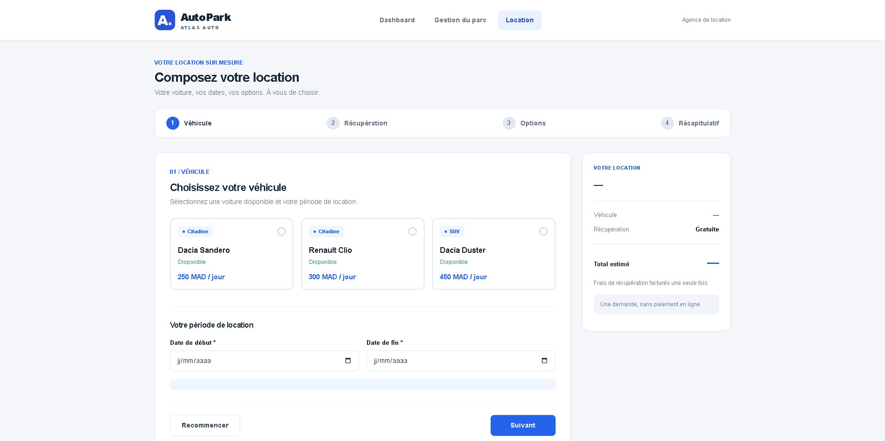
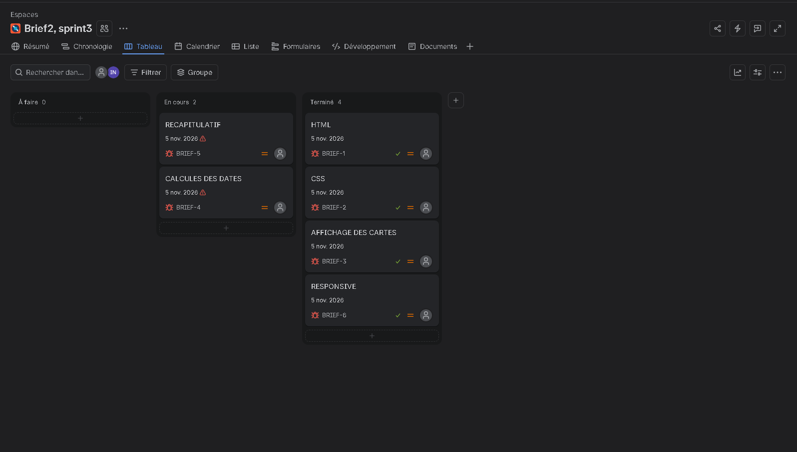

# AutoPark — Configurateur de location

Interface client de l'application **AutoPark**, développée pour **Atlas Auto**, une agence fictive de location de voitures. Elle permet au client de composer sa location : choisir un véhicule, définir sa période et suivre le prix estimé en temps réel.

L'application fonctionne **uniquement dans le navigateur**, sans backend.

---

## Sommaire

- [Aperçu](#aperçu)
- [Fonctionnalités](#fonctionnalités)
- [Technologies](#technologies)
- [Structure du projet](#structure-du-projet)
- [Lancer le projet](#lancer-le-projet)
- [Fonctionnement du code](#fonctionnement-du-code)
- [Organisation du travail](#organisation-du-travail)
- [Auteur](#auteur)

---

## Aperçu




---

## Fonctionnalités

### Choix du véhicule
- Les cartes des véhicules sont **générées dynamiquement en JavaScript** à partir d'un jeu de données (marque, modèle, immatriculation, catégorie, tarif journalier, statut).
- Chaque carte affiche la catégorie, le nom du véhicule, son statut et son **tarif par jour**.
- La sélection se fait par boutons radio : un seul véhicule peut être choisi à la fois.
- Le premier véhicule disponible est présélectionné.
- Un véhicule non disponible est grisé et ne peut pas être sélectionné.

### Carte « Votre location »
- Un récapitulatif à droite du formulaire se met à jour **en temps réel** à chaque changement de véhicule ou de dates :


### Validation et boutons
- Bouton **Recommencer** : remet le formulaire et la carte récapitulative à leur état initial.
- Indicateur de progression (stepper) en haut de la page, avec l'étape active mise en évidence.

### Interface et accessibilité
- Interface **responsive** : desktop, tablette et mobile (le formulaire et la carte récapitulative s'empilent sur petit écran, le stepper reste lisible).
- Structure HTML5 **sémantique** (`header`, `nav`, `main`, `section`, `aside`, `article`), avec un `label` associé à chaque champ.
- **Navigation au clavier** possible, avec un focus visible sur les cartes, les champs et les boutons.
- Annonce de la durée aux lecteurs d'écran (`aria-live`) et attributs ARIA sur les éléments décoratifs.

---

## Technologies

| Technologie | Utilisation |
|---|---|
| **HTML5** | Structure sémantique de la page |
| **CSS3** | Mise en page (Grid, Flexbox), sélecteur `:has()`, media queries, design responsive |
| **JavaScript (Vanilla)** | Manipulation du DOM, `addEventListener`, calculs de prix, `Intl` pour le format des montants |

---

## Structure du projet

```
auto-park-starter/
├── css/
│   ├── style.css        # Styles partagés
│   └── style2.css       # Styles de la page de location
├── js/
│   ├── data.js          # Données du projet
│   ├── location.js      # Page de location : cartes, dates, calcul du prix, récapitulatif
│   └── voitures.js      # Script de la page Gestion du parc
├── docs/                # Captures d'écran (Jira, aperçus)
├── index.html           # Dashboard
├── location.html        # Page du configurateur de location
├── voitures.html        # Gestion du parc
└── README.md
```

---

## Lancer le projet

Aucune installation n'est nécessaire.

1. Cloner le dépôt :
   ```bash
   git clone <url-du-depot>
   cd <nom-du-depot>
   ```
2. Ouvrir `location.html` dans un navigateur moderne (Chrome, Firefox, Edge, Safari).

Option : avec VS Code, lancer la page avec l'extension **Live Server** (clic droit sur `location.html` → *Open with Live Server*).

---

## Fonctionnement du code

Le fichier `js/location.js` regroupe des fonctions courtes, chacune avec un rôle précis :

| Fonction | Rôle |
|---|---|
| `carSelect(conf)` | Crée les cartes des véhicules (radio, label, badge, prix) et les ajoute dans la grille |


## Organisation du travail

Les tâches du projet ont été planifiées et suivies dans **Jira**.



## Auteur

ILYAS NABIH — Développeur web junior
Projet réalisé dans le cadre de la formation, du 02 au 05 novembre 2026.
